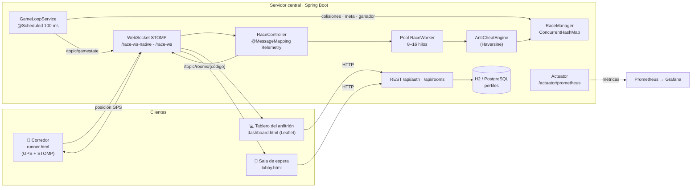
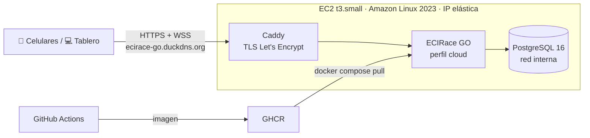

<div align="center">

# 🏁 ECIRace GO
### The Colombian Race Competence is Here

**Carreras multijugador en tiempo real sobre el mundo físico, usando el GPS del celular.**


Proyecto del curso **Arquitecturas de Software (ARSW)** · Escuela Colombiana de Ingeniería Julio Garavito · 2026-2

### 🌐 [ecirace-go.duckdns.org](https://ecirace-go.duckdns.org)

<sub>Desplegado en AWS. Para ahorrar créditos, el servidor solo está encendido durante clases, demos y pruebas.</sub>

</div>

---

## Tabla de contenido

1. [Descripción](#-descripción)
2. [Equipo](#-equipo)
3. [Funcionalidades](#-funcionalidades)
4. [Arquitectura](#-arquitectura)
5. [Tecnologías](#-tecnologías)
6. [Estructura del repositorio](#-estructura-del-repositorio)
7. [Cómo arrancar el proyecto](#-cómo-arrancar-el-proyecto)
8. [Cómo jugar](#-cómo-jugar)
9. [API REST y canales WebSocket](#-api-rest-y-canales-websocket)
10. [Pruebas](#-pruebas)
11. [Observabilidad y pruebas de rendimiento](#-observabilidad-y-pruebas-de-rendimiento)
12. [Integración y entrega continua](#-integración-y-entrega-continua)
13. [Despliegue en AWS](#️-despliegue-en-aws)
14. [Gestión del proyecto (Sprints)](#-gestión-del-proyecto-sprints)

---

## 📖 Descripción

**ECIRace GO** convierte el campus (o cualquier lugar) en una pista de carreras. Cada jugador abre la aplicación en su celular y su **posición GPS real** se transmite por **WebSocket** a un **servidor central autoritativo**. El servidor:

- **valida** cada posición con un **motor anti-trampa** basado en la fórmula de Haversine (descarta velocidades imposibles),
- **avanza la simulación** en un *game loop* de **100 ms** (posiciones, colisiones y meta),
- **difunde** el estado de la carrera a todos los jugadores y al **tablero del anfitrión**, que muestra el mapa en vivo,
- **declara de forma atómica a un único ganador** cuando alguien cruza la meta.

El proyecto se centra en los problemas clásicos de la asignatura: **concurrencia** (estructuras thread-safe, pool de hilos y bloqueos), **comunicación en tiempo real**, **consistencia del estado compartido**, **observabilidad**, **rendimiento bajo carga** y **despliegue en la nube**.

## 👥 Equipo

| Integrante | GitHub |
|---|---|
| **Cristian Andrés Aristizábal Parra** | [@Cristian-Aristi](https://github.com/Cristian-Aristi) |
| **Santiago Andrés Pinzón Torres** | [@els4nty](https://github.com/els4nty) |

Gestión del proyecto en **Azure DevOps** (Boards por sprint) y código en **GitHub**.

## ✨ Funcionalidades

| Módulo | Descripción |
|---|---|
| **Ingreso de pilotos** | Ingreso como invitado o con Google y un *tag* de piloto. El perfil y su historial de carreras (jugadas y ganadas) se guardan con Spring Data JPA. |
| **Salas de carrera** | El anfitrión crea una sala con código propio. Tiene un cupo de **6 jugadores**, solo el anfitrión inicia la carrera y no se puede entrar a una carrera en curso. Se comparte por enlace de invitación. |
| **Selección de vehículo** | Catálogo de vehículos colombianos con su velocidad máxima y color: **Renault 4** (28 km/h), **Chevrolet Spark GT** (30 km/h) y **Mazda 323** (32 km/h). |
| **Telemetría GPS** | El celular usa la API de Geolocalización del navegador y envía la posición por STOMP. Hay un endpoint WebSocket **nativo** compatible con ngrok y redes móviles, con *heartbeats* de 10 s y reconexión automática. |
| **Motor anti-trampa** | Calcula la velocidad entre posiciones con Haversine y descarta la telemetría anómala. También reordena los paquetes que llegan desordenados dentro de una ventana de 5 s. |
| **Game loop** | `@Scheduled` cada **100 ms**: procesa posiciones, resuelve **colisiones** (umbral de 1,5 m con desaceleración) y detecta el cruce de **meta** por radio. |
| **Ganador único** | Declaración atómica del ganador y cierre de la carrera. El resultado se difunde a la sala y se guarda en el perfil. |
| **Tablero del anfitrión** | Mapa en vivo con Leaflet, lista de pilotos, ubicación de la meta y una consola con los eventos de sockets y del anti-trampa. |
| **Observabilidad** | Métricas de HTTP, WebSockets, game loop, salas y pool de hilos con Actuator y Micrometer. Incluye tableros de Grafana y pruebas de rendimiento con k6. |
| **Modo laboratorio** | Simulación de fallas, latencia y capacidad sobre la API para practicar la detección de incidentes. Está desactivado por defecto. |

## 🏗 Arquitectura



**Decisiones de diseño**

- **Servidor autoritativo.** El cliente solo reporta su posición. El servidor decide qué es válido, quién colisiona y quién gana, lo que evita trampas desde el navegador.
- **Recepción desacoplada del procesamiento.** Los frames STOMP se entregan a un `ThreadPoolTaskExecutor` (`RaceWorker`, 8–16 hilos, cola de 100, `CallerRunsPolicy`). Así el hilo del socket no se bloquea.
- **Estado compartido concurrente.** Las posiciones viven en un `ConcurrentHashMap`. El ganador se declara de forma atómica para que dos llegadas simultáneas no produzcan dos ganadores.
- **Broker en memoria y una sola instancia.** Las salas, el game loop y el broker STOMP simple viven en memoria. Por eso el despliegue usa **una réplica**. Para escalar horizontalmente habría que pasar a un broker externo (Redis o RabbitMQ).

## 🧰 Tecnologías

| Capa | Tecnologías |
|---|---|
| Backend | Java 21, Spring Boot 4.1.1 (Web MVC, WebSocket/STOMP, Data JPA, Actuator) |
| Persistencia | H2 en memoria (local) · PostgreSQL 16 (AWS) |
| Frontend | HTML, CSS y JavaScript, Leaflet, STOMP sobre WebSocket nativo y SockJS |
| Observabilidad | Micrometer, Prometheus 3.7, Grafana 12.2, sonda de disponibilidad en Python |
| Rendimiento | k6 1.3 (API REST y carreras completas por WebSocket) |
| Contenedores | Docker multi-stage (Maven → JRE Alpine), Docker Compose |
| CI/CD | GitHub Actions, GitHub Container Registry, Azure DevOps Pipelines |
| Nube | AWS EC2 (Learner Lab), CloudFormation, Caddy (TLS automático), SSM |

## 📂 Estructura del repositorio

```text
.
├── src/main/java/edu/eci/arsw/eciracego/
│   ├── config/          # WebSocket/STOMP, pool de hilos RaceWorker, eventos de conexión
│   ├── controller/      # AuthController, RoomController (REST) · RaceController (STOMP)
│   ├── service/         # RaceManager, GameLoopService, AntiCheatEngine, Auth/RoomService
│   ├── model/           # Room, Ubication, UserProfile, VehicleType
│   ├── repository/      # UserProfileRepository (Spring Data JPA)
│   ├── dto/             # Peticiones de autenticación y creación de sala
│   ├── observability/   # Métricas de WebSocket, interceptor STOMP y gauges del proyecto
│   └── lab/             # Modo laboratorio: fallas, latencia y capacidad simuladas
├── src/main/resources/
│   ├── static/          # index, lobby, runner y dashboard (HTML, JS, CSS, imágenes)
│   ├── application.properties         # Configuración local (H2)
│   └── application-cloud.properties   # Perfil de nube (PostgreSQL por variables)
├── src/test/java/...    # Pruebas de anti-trampa, salas, game loop, auth, observabilidad y laboratorio
├── monitoring/          # Prometheus, Grafana (datasource y tableros) y sonda
├── k6/                  # tests.js (laboratorio) · proyecto.js (todo ECIRace)
├── k6-grafana/          # Exportador de resultados de k6 a Prometheus
├── results/             # Evidencia de las ejecuciones de k6
├── scripts/
│   ├── lab.py           # Automatiza el laboratorio de observabilidad y rendimiento
│   └── aws.py           # Despliega, enciende y apaga el entorno en AWS
├── deploy/aws/          # CloudFormation, Docker Compose de producción, Caddyfile y bootstrap
├── .github/workflows/   # ci.yml · cd.yml
├── Dockerfile           # Imagen multi-stage del servidor
├── docker-compose.yml   # Servidor + Prometheus + Grafana + sonda + k6
├── docker-compose.cloud.yml  # Observabilidad local apuntando a la nube
├── azure-pipelines.yml  # Pipeline de Azure DevOps
└── CONSULTAS.md         # Guía de consultas PromQL de los tableros
```

## 🚀 Cómo arrancar el proyecto

### Requisitos

| Herramienta | Versión | Para qué |
|---|---|---|
| JDK | 21 | Compilar y ejecutar el servidor |
| Maven | 3.9+ (o el wrapper `mvnw` incluido) | Construcción |
| Docker y Docker Compose v2 | Recientes | Contenedores y observabilidad |
| Python | 3.10+ | `scripts/lab.py` y `scripts/aws.py` |
| ngrok *(opcional)* | — | HTTPS para probar con celulares en local |

### Opción 1: Maven (desarrollo)

```bash
git clone https://github.com/Cristian-Aristi/ECIRace_Go_The_Colombian_Race_Competence_is_Here.git
cd ECIRace_Go_The_Colombian_Race_Competence_is_Here

# Linux / macOS
./mvnw spring-boot:run
# Windows
mvnw.cmd spring-boot:run
```

El servidor queda en **http://localhost:8080**.

| Recurso | URL |
|---|---|
| Aplicación | http://localhost:8080 |
| Consola H2 | http://localhost:8080/h2-console (JDBC `jdbc:h2:mem:eciracedb`, usuario `sa`) |
| Salud | http://localhost:8080/actuator/health |
| Métricas | http://localhost:8080/actuator/prometheus |

### Opción 2: Docker

```bash
docker build -t ecirace-go .
docker run -p 8080:8080 ecirace-go
```

### Opción 3: Entorno completo (servidor + observabilidad)

```bash
python scripts/lab.py prepare   # descarga y construye las imágenes
python scripts/lab.py up        # servidor, Prometheus, Grafana, sonda y exportador k6
python scripts/lab.py doctor    # verifica que todos los targets estén UP
```

| Servicio | URL | Credenciales |
|---|---|---|
| ECIRace GO | http://localhost:8080 | — |
| Prometheus | http://localhost:9090 | — |
| Grafana | http://localhost:3000 | `admin` / `arsw-lab-2026` |

Para apagar el entorno: `python scripts/lab.py down`.

### Probar con celulares en local

Los navegadores solo entregan la ubicación GPS en un **contexto seguro (HTTPS)**. Para probar con teléfonos reales sin desplegar:

```bash
ngrok http 8080
```

Abre la URL `https://...ngrok...` en el computador y en los celulares. El cliente detecta HTTPS y se conecta automáticamente por `wss://`.

## 🎮 Cómo jugar

1. **Anfitrión.** En `index.html` ingresa como invitado o con Google y **crea una sala** (código propio o generado). Se abre el **tablero** con el mapa.
2. **Invitar.** Desde el tablero copia el **enlace de la sala** y compártelo con los pilotos (máximo 6).
3. **Pilotos.** Abren el enlace en el celular, ingresan su *tag*, **eligen vehículo** y esperan en la sala.
4. **Meta.** El anfitrión ubica la **línea de meta** con un clic en el mapa y **inicia la carrera**.
5. **Carrera.** Los celulares transmiten su GPS. El tablero muestra a todos en vivo, la consola registra la telemetría aceptada y la descartada por el anti-trampa, y el game loop resuelve las colisiones.
6. **Ganador.** El primero en entrar al radio de la meta gana. El resultado llega a todos y se guarda en el perfil del piloto.

## 🔌 API REST y canales WebSocket

### REST

| Método | Ruta | Descripción |
|---|---|---|
| `POST` | `/api/auth/guest` | Ingreso como invitado |
| `POST` | `/api/auth/google` | Ingreso con Google y *tag* de piloto |
| `GET` | `/api/auth/profile/{username}` | Perfil y estadísticas del piloto |
| `PUT` | `/api/auth/username` | Cambiar el *tag* |
| `POST` | `/api/auth/race-result` | Registrar el resultado de una carrera |
| `POST` | `/api/rooms/create` | Crear sala |
| `GET` | `/api/rooms` | Listar salas |
| `GET` | `/api/rooms/{code}` | Consultar una sala |
| `POST` | `/api/rooms/{code}/join` | Unirse a una sala |
| `POST` | `/api/rooms/{code}/start` | Iniciar la carrera (solo el anfitrión, con las coordenadas de la meta) |
| `GET` | `/api/rooms/{code}/positions` | Última posición conocida de cada corredor |

### WebSocket (STOMP)

| Tipo | Destino | Descripción |
|---|---|---|
| Endpoint | `/race-ws-native` | WebSocket nativo (producción, ngrok, AWS) |
| Endpoint | `/race-ws` | WebSocket con SockJS (compatibilidad local) |
| Envío | `/app/telemetry` | Posición GPS del corredor |
| Suscripción | `/topic/rooms/{code}` | Telemetría aceptada de la sala |
| Suscripción | `/topic/rooms/{code}/status` | Estado de la sala (jugadores, inicio, ganador) |
| Suscripción | `/topic/gamestate` | Estado global emitido por el game loop |

## 🧪 Pruebas

```bash
./mvnw test
```

Hay **31 pruebas automatizadas** organizadas en las siguientes suites:

| Suite | Pruebas | Qué verifica |
|---|---|---|
| `AntiCheatEngineTest` | 4 | Distancia y velocidad con Haversine y descarte de telemetría anómala |
| `RoomServiceTest` | 7 | Creación de salas (código automático y propio, duplicados), cupo de 6 y que solo el anfitrión inicie |
| `GameLoopServiceTest` | 2 | Resolución de colisiones según el umbral de distancia |
| `AuthServiceTest` | 6 | Ingreso, perfiles, cambio de *tag* y registro de resultados |
| `ProjectObservabilityTest` | 4 | Exposición de las métricas del proyecto |
| `LabModeTest` | 7 | Fallas, latencia y capacidad del modo laboratorio |
| `EciRaceGoApplicationTests` | 1 | Arranque del contexto de Spring |

## 📊 Observabilidad y pruebas de rendimiento

El servidor publica en `/actuator/prometheus` las métricas de:

- latencia HTTP por endpoint (histograma de 5 ms a 5 s),
- sesiones y mensajes STOMP (`ecirace_ws_*`),
- duración del *tick* del game loop,
- salas por estado (`ecirace_rooms`),
- corredores activos,
- cola del pool `RaceWorker`,
- conexiones a la base de datos.

**Tableros de Grafana** (aprovisionados automáticamente):

- **ECIRace GO Observabilidad**: los 8 paneles del laboratorio (disponibilidad, errores, *throughput*, P95, capacidad y CPU).
- **ECIRace GO Proyecto**: API REST, WebSockets, telemetría, difusión, game loop, salas y pool.
- **k6 Resultados por ejecución**: resumen de cada prueba de carga.

La guía de cada consulta está en [`CONSULTAS.md`](CONSULTAS.md).

**Pruebas con k6**

```bash
python scripts/lab.py test carga          # laboratorio: carga | estres | pico | duracion | all
python scripts/lab.py proyecto all        # todo ECIRace: API REST + carreras completas por WebSocket
python scripts/lab.py fault               # simula una falla de 30 s (modo laboratorio)
```

`proyecto.js` simula carreras completas: crea la sala, une a los pilotos por WebSocket, envía la telemetría y mide la latencia de ida y vuelta y la detección de la meta. Los resultados quedan en `results/` y en Grafana.

## 🔄 Integración y entrega continua

| Pipeline | Disparador | Qué hace |
|---|---|---|
| `.github/workflows/ci.yml` | push / PR a `main` | Compila y ejecuta las pruebas con JDK 21 |
| `.github/workflows/cd.yml` | push a `main` / rama del sprint | Ejecuta las pruebas y publica la imagen en **GHCR** (`ghcr.io/cristian-aristi/ecirace-go`, etiquetas `sha-<commit>` y `latest`) |
| `azure-pipelines.yml` | push a `main` | Compilación, pruebas y construcción de la imagen en Azure DevOps |

## ☁️ Despliegue en AWS

> **¿Por qué AWS y no Azure?** El Sprint 8 se diseñó primero sobre Azure Container Apps. No pudimos usarlo porque la cuenta de la Escuela no tenía créditos de Azure (Azure for Students no se podía renovar) y la universidad nos asignó **AWS Academy Learner Lab**. El diseño de Azure quedó en el historial de commits. Como el código solo depende del perfil `cloud`, el cambio de nube no tocó la aplicación.

La aplicación está publicada en **https://ecirace-go.duckdns.org** y corre en **una instancia EC2** con Docker Compose. Toda la infraestructura está descrita como código en [`deploy/aws/cloudformation.yaml`](deploy/aws/cloudformation.yaml).



| Decisión | Motivo |
|---|---|
| **EC2 + Docker Compose** | App Runner no soporta WebSockets. Un balanceador (ALB) necesita dominio propio para el certificado y cobra aunque nadie lo use. |
| **Caddy + DuckDNS** | El GPS del celular exige HTTPS. Caddy obtiene solo el certificado de Let's Encrypt para `ecirace-go.duckdns.org`, un subdominio gratuito. `<ip>.sslip.io` queda activo como respaldo. |
| **IP elástica** | La URL no cambia al encender y apagar, y Caddy no pide un certificado nuevo cada vez. |
| **Una sola instancia** | Las salas, el game loop y el broker STOMP viven en memoria. |
| **PostgreSQL en contenedor** | Evita el costo fijo de RDS. Vive en una red interna sin puertos expuestos. Su clave se genera dentro de la instancia y nunca sale de ella. |
| **Sin puerto 22** | Se administra por SSM (`LabInstanceProfile`). Además, IMDSv2 es obligatorio y el disco está cifrado. |
| **Actuator cerrado** | Solo se exponen `/actuator/health` y `/actuator/prometheus`, este último con usuario y contraseña. `/admin` y `/h2-console` responden 404. |

El CD (`.github/workflows/cd.yml`) solo publica la imagen. Learner Lab entrega **credenciales temporales**, así que el despliegue se hace desde el equipo con `scripts/aws.py`.

### Paso a paso

1. **Iniciar el laboratorio.** En AWS Academy, entra a **Learner Lab → Start Lab** y espera a que el indicador se ponga en verde.
2. **Configurar credenciales** (en cada sesión). Ve a **AWS Details → AWS CLI → Show** y copia el bloque en `~/.aws/credentials` (en Windows: `%UserProfile%\.aws\credentials`). Necesitas [AWS CLI v2](https://docs.aws.amazon.com/cli/latest/userguide/getting-started-install.html).
3. **Desplegar** (la primera vez tarda ~5 min):

```bash
python scripts/aws.py check       # verifica credenciales y región (us-east-1)
python scripts/aws.py deploy      # crea o actualiza todo e imprime la URL https://<ip>.sslip.io
```

### Dominio propio (opcional)

Por defecto la URL es `https://<ip>.sslip.io`. Para usar un nombre propio, por ejemplo un subdominio gratuito de [DuckDNS](https://www.duckdns.org):

1. Crea el subdominio y apúntalo a la IP elástica. La ves con `python scripts/aws.py status` o en la salida del `deploy`.
2. Ejecuta `python scripts/aws.py deploy --domain ecirace-go.duckdns.org`.
   - El script verifica que el DNS apunte a la instancia y reinicia la máquina una vez (los datos se conservan).
   - Caddy obtiene el certificado del dominio nuevo. La URL de `sslip.io` sigue activa como respaldo.
   - Para volver a usar solo `sslip.io`: `deploy --domain ""`.

### Operación diaria

```bash
python scripts/aws.py up          # antes de clase o demo: enciende y descarga la última imagen
python scripts/aws.py down        # al terminar: sin costo de cómputo (URL y datos se conservan)
python scripts/aws.py status      # estado de la instancia, URL y salud
python scripts/aws.py release     # aplica la última imagen publicada sin apagar (SSM)
python scripts/aws.py logs app    # últimas líneas de app | caddy | postgres
python scripts/aws.py monitor up  # Grafana local con las métricas de AWS
python scripts/aws.py k6 carga    # pruebas de carga contra la URL pública
python scripts/aws.py destroy     # elimina toda la infraestructura
```

> 💡 Usa `up` antes de una demo y **siempre `down` al terminar**. Learner Lab también detiene la instancia al cerrar la sesión, pero lo que quede encendido consume créditos del laboratorio.
>
> 🔐 El archivo `deploy/aws/.aws-deploy.json` guarda la contraseña de métricas. Está en `.gitignore`: compártelo solo por privado con quien vaya a operar el despliegue.

## 📅 Gestión del proyecto (Sprints)

| Sprint | Fechas | Entregables principales |
|---|---|---|
| **1** | 5–12 sep | Proyecto Maven, estructura concurrente (`ConcurrentHashMap`), controlador WebSocket, cliente emisor GPS |
| **2** | 13–19 sep | Arquitectura y sustentación, captura GPS con HUD, canal STOMP continuo, procesamiento paralelo |
| **3** | 20–26 sep | Motor anti-trampa con Haversine, Dockerfile multi-stage, Docker Compose, CI con GitHub Actions y Azure Pipelines |
| **4** | 27 sep–3 oct | Acceso como invitado, perfil del piloto y *tag*, selección de vehículos, identidad en salas y mapa en vivo |
| **5** | 5–10 oct | Game loop de 100 ms, línea de meta, colisiones, ganador único e interfaz de resultados · **Release 1** |
| **6** | 19–24 oct | Estabilización del Release 1, catálogo visual de vehículos, conectividad robusta (WebSocket nativo, *heartbeats*, reconexión) |
| **7** | 26–31 oct | Observabilidad: Actuator y Prometheus, modo laboratorio, Grafana, sonda y pruebas de rendimiento con k6 |
| **8** | 2–7 nov | Despliegue en la nube: diseño inicial en Azure y migración a AWS Learner Lab (EC2, Caddy, CloudFormation), entrega continua a GHCR y operación con control de créditos |

El detalle de historias de usuario (con criterios Gherkin) y tareas está en el tablero de **Azure DevOps** del proyecto.

---

<div align="center">

Hecho con concurrencia en la **Escuela Colombiana de Ingeniería Julio Garavito** · ARSW 2026-2

</div>
